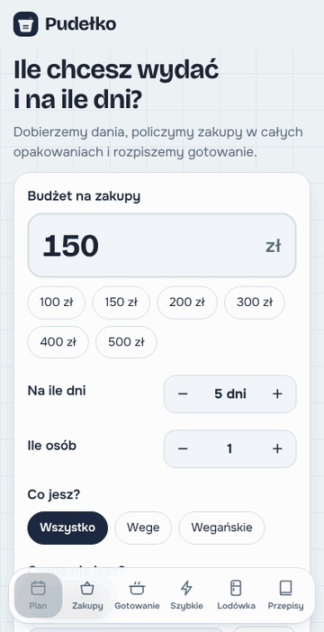

# Pudełko meal planner 🥡

**Budget meal planner: shopping list, calories and cooking plan in one place.**

Tell it how much you want to spend and for how many days. Pudełko (Polish for "little box") plans breakfasts, lunches and suppers, counts the shopping in whole packages and schedules what to cook when. It runs in the browser, with no account and no server, and works offline.

<p align="center">
  
</p>

The interface is in Polish, since it works with Polish recipes, products and store prices.

## Features

- **A plan that fits the budget.** Breakfast, lunch and supper every day, with a daily calorie target of 1200, 1500, 1750, 2000, 2200 or 3000 kcal. Portions scale to hit it, and any dish can be rerolled or swapped, with the shopping cost updated instantly.
- **Shopping list in whole packages.** With prices, grouped by store section, showing what will be left over. Checked items move to the fridge, and the list can be shared or copied.
- **Fridge.** Type in what you already have and the next plan uses it up. Cooked dishes take their ingredients out of the fridge.
- **Cooking schedule.** Meal prep laid out: what to cook on day one, what mid-week (when a dish won't keep that long) and what to freeze.
- **Preferences.** Ingredients to avoid (with inflections and synonyms, e.g. "papryka" also excludes chili and ajvar), lactose-free products, a "least time at the stove" mode, air fryer instead of an oven, price per dish (cheap, medium, expensive), sweet or savory breakfasts and suppers, vegetarian, vegan or gluten-free.
- **Rotation.** Dishes from the last two weeks don't come back, and every reroll on the same day brings different dishes.
- **Learns your taste.** 👍 and 👎 on dishes. Pudełko remembers the ingredients and flavor pairings you like and suggests them more often. Rejected dishes never show up again.
- **Quick & healthy.** A separate tab with lunches under 25 minutes and breakfasts under 15, with few ingredients, including no-cook options.
- **PWA.** Installable on a phone. All data stays in the browser (localStorage).

## Running it

No dependencies and no build step. Any static file server will do:

```sh
python3 -m http.server 8000
# open http://localhost:8000
```

The whole app can also be bundled into a single HTML file, e.g. to open it on a phone without a server:

```sh
node tools/build-single.mjs pudelko.html
```

## How it works

| File | What it does |
| --- | --- |
| `js/data.js` | Product list (package size, price, calories, protein) and built-in recipes. |
| `js/prices.js` | Current Biedronka prices, generated by `tools/update-prices.mjs`. |
| `js/planner.js` | Planning algorithm, shopping list, nutrition, filters and taste learning. |
| `js/app.js` | User interface: plain JavaScript, no framework. |
| `sw.js` | Offline cache. |
| `tools/build-single.mjs` | Bundles everything into one HTML file. |

**Planning.** The planner samples a few thousand combinations of dishes that pass the filters. For each one it computes the cost of shopping in whole packages, minus what's already in the fridge, so dishes that share ingredients come out cheaper. It adds penalties for extra cooking sessions during the week and for straying from the calorie target, and a bonus for dishes that match your taste. The final plan is drawn from the best plans within budget, so consecutive rerolls differ.

**Taste.** Each dish is described by features: products, word stems from its ingredients and name, and dish kind. Liked and rejected dishes build a profile weighted by feature rarity (IDF), including feature pairs, i.e. flavor combinations. The profile shifts the odds of a dish being picked without shutting out new ones.

**Prices** come from Biedronka's online grocery store ([zakupy.biedronka.pl](https://zakupy.biedronka.pl)). `python3 tools/fetch_biedronka.py` downloads the current food prices (category listings only, as robots.txt allows), and `node tools/update-prices.mjs` matches each product in the price list to the cheapest comparable Biedronka product and writes `js/prices.js`. Products the online store doesn't carry keep estimated prices from `js/data.js`. Run both again to refresh prices; `--report` shows each match.

## Extra recipe packs

Besides the built-in recipes, Pudełko loads optional packs `js/recipes-<source>.js` when they exist; without them the app runs on the built-in recipes alone. A pack exports an array of recipes in the same format as `RECIPES` in `js/data.js`. It can also set `source` (a link to the original, shown as a button instead of the steps), `site`, `totalTime` and `nutr` (kcal and protein per portion):

```js
export const MY_RECIPES = [{
  id: 'my-orzo', name: 'Orzo z kurczakiem', type: 'obiad', emoji: '🍗', serves: 3, keeps: 3, freezes: false, tags: [],
  ing: { piers: 400, makaron: 200, szpinak: 100 }, // product ids from INGREDIENTS → grams or pieces
  source: 'https://…', site: 'mine', totalTime: 30,
}];
```

## Recipe sources

On top of the built-in recipes, Pudełko uses about 5,200 dishes from four Polish recipe sites: [Ania Gotuje](https://aniagotuje.pl) (710), [Kuchnia Lidla](https://kuchnialidla.pl) (2,559), [Kwestia Smaku](https://www.kwestiasmaku.com) (891) and [Centrum Respo](https://centrumrespo.pl) (1,062). The app stores only names, ingredients with quantities (for the shopping list), nutrition and links. For the recipe itself you always click through to the original.

- `tools/fetch_*.py` downloads the data into `data/*-raw.json`, respecting robots.txt crawl delays, and resumes interrupted downloads.
- `node tools/build-recipes.mjs [ania|lidl|ks|respo]` converts free-text ingredients ("2 ząbki czosnku", "pół szklanki mleka") into products from the price list and builds `js/recipes-*.js`.

This is a project for personal use.
